<a id="top"></a>

<p align="center">
  
</p>

<p align="center">
  <a href="https://git.io/typing-svg">
    
  </a>
</p>

<p align="center">
  <a href="#user-content-sobre">Sobre</a> &nbsp; / &nbsp;
  <a href="#user-content-tecnologias">Tecnologias</a> &nbsp; / &nbsp;
  <a href="#user-content-explorar">Explorar</a> &nbsp; / &nbsp;
  <a href="#user-content-atividade">Atividade</a> &nbsp; / &nbsp;
  <a href="#user-content-contato">Contato</a>
</p>

<p align="center">
  <a href="https://www.linkedin.com/in/matheusdolenga"></a>
  <a href="mailto:matheusdolenga21@gmail.com"></a>
  <a href="https://github.com/matheusdolenga?tab=repositories"></a>
  <a href="https://github.com/matheusdolenga?tab=followers"></a>
</p>


<a id="sobre"></a>

## 🧭 Por trás dos projetos

Sou **Matheus Dolenga**. Este é meu espaço para explorar tecnologia, testar ideias e construir coisas que façam sentido na prática.

Me interessam o desenvolvimento de software, a automação e as ferramentas que ajudam a resolver problemas do dia a dia. Por aqui, cada projeto é também uma oportunidade de aprender, experimentar e melhorar.

<table>
  <tr>
    <td width="33%" valign="top">
      <h3>🔎 Explorar</h3>
      <p>Entender como as coisas funcionam, conhecer ferramentas e conectar ideias.</p>
    </td>
    <td width="33%" valign="top">
      <h3>🛠️ Construir</h3>
      <p>Transformar uma ideia em algo que possa ser usado, testado e aperfeiçoado.</p>
    </td>
    <td width="33%" valign="top">
      <h3>🌱 Evoluir</h3>
      <p>Aprender com a prática, revisar decisões e melhorar um passo de cada vez.</p>
    </td>
  </tr>
</table>

<details>
<summary><b>💻 Abrir meu arquivo de configuração</b></summary>

```json
{
  "nome": "Matheus Dolenga",
  "interesses": [
    "Desenvolvimento de software",
    "Automação",
    "Projetos pessoais",
    "Aprendizado na prática"
  ],
  "modo": "explorar → construir → aprender → melhorar",
  "status": "sempre em construção"
}
```

</details>

<details>
<summary><b>🌎 Read this introduction in English</b></summary>

### Hi, I'm Matheus.

This is my space to explore technology, experiment with ideas, and build useful things.

I'm interested in software development, automation, and tools that solve everyday problems. Here you'll find personal projects, experiments, and things I learn along the way.

**Explore → Build → Learn → Improve.**

[Browse my repositories](https://github.com/matheusdolenga?tab=repositories) · [LinkedIn](https://www.linkedin.com/in/matheusdolenga) · [Get in touch](mailto:matheusdolenga21@gmail.com)

</details>


<a id="tecnologias"></a>

## ⚡ Tecnologias no meu radar

<p align="center">
  <a href="https://skillicons.dev">
    
  </a>
</p>

<p align="center">
  <code>Desenvolvimento web</code> &nbsp;
  <code>Automação</code> &nbsp;
  <code>Versionamento</code> &nbsp;
  <code>Experimentação</code>
</p>

<details>
<summary><b>📚 Explorar linguagens e ferramentas</b></summary>

| Área de interesse | Atalhos |
| :--- | :--- |
| Linguagens | [Python](https://www.python.org/) · [JavaScript](https://developer.mozilla.org/pt-BR/docs/Web/JavaScript) · [C++](https://isocpp.org/) |
| Web | [HTML](https://developer.mozilla.org/pt-BR/docs/Web/HTML) · [CSS](https://developer.mozilla.org/pt-BR/docs/Web/CSS) |
| Ferramentas | [Git](https://git-scm.com/) · [GitHub](https://github.com/) · [VS Code](https://code.visualstudio.com/) |

</details>


<a id="explorar"></a>

## 🗂️ Explore meu GitHub

<table>
  <tr>
    <td width="50%" valign="top">
      <h3>🚀 Repositórios</h3>
      <p>Projetos, estudos e experimentos em um só lugar.</p>
      <a href="https://github.com/matheusdolenga?tab=repositories">Ver todos os repositórios →</a>
    </td>
    <td width="50%" valign="top">
      <h3>⭐ Descobertas</h3>
      <p>Ferramentas e projetos que salvei para acompanhar ou explorar.</p>
      <a href="https://github.com/matheusdolenga?tab=stars">Explorar minhas estrelas →</a>
    </td>
  </tr>
</table>

<p align="center">
  <b>Filtrar repositórios por linguagem</b><br /><br />
  <a href="https://github.com/matheusdolenga?tab=repositories&amp;language=python"></a>
  <a href="https://github.com/matheusdolenga?tab=repositories&amp;language=javascript"></a>
  <a href="https://github.com/matheusdolenga?tab=repositories&amp;language=c%2B%2B"></a>
</p>


<a id="atividade"></a>

## 📊 Código em movimento

<p align="center">
  <a href="https://github.com/matheusdolenga?tab=overview">
    
  </a>
  <a href="https://github.com/matheusdolenga?tab=repositories">
    
  </a>
</p>

<p align="center">
  <a href="https://github.com/matheusdolenga?tab=overview">
    
  </a>
</p>

<details>
<summary><b>🔗 Ver atividade diretamente no GitHub e conhecer os widgets</b></summary>

- [Contribuições e atividade](https://github.com/matheusdolenga?tab=overview)
- [Repositórios públicos](https://github.com/matheusdolenga?tab=repositories)
- [Seguidores](https://github.com/matheusdolenga?tab=followers)

Os cartões refletem dados públicos, usam cache e podem levar algum tempo para atualizar.

Recursos visuais: [Readme Typing SVG](https://github.com/DenverCoder1/readme-typing-svg), [Skill Icons](https://github.com/tandpfun/skill-icons), [Shields.io](https://shields.io/), [Profile Summary Cards](https://github.com/vn7n24fzkq/github-profile-summary-cards). Banner e divisores próprios em [assets](assets/).

</details>


<a id="contato"></a>

## 🤝 Vamos trocar uma ideia?

Uma ferramenta interessante, um projeto ou uma boa conversa sobre tecnologia: os caminhos estão aqui.

<p align="center">
  <a href="https://www.linkedin.com/in/matheusdolenga"></a>
  <a href="mailto:matheusdolenga21@gmail.com"></a>
</p>

<p align="center">
  <sub>Uma ideia de cada vez. Um projeto em evolução.</sub><br /><br />
  <a href="#user-content-top">↑ Voltar ao topo</a>
</p>
